<!-- ============================== HEADER ============================== -->

  

  

  
  

---

<h1 align="center">Hi 👋, We're Coding Guruji</h1>
<h3 align="center">Your Daily Dose of Code &amp; Motivation. We create practical coding content, tutorials and career guidance to help learners become confident, job-ready developers.</h3>

  
  
  

 

🔭 We're currently building free learning resources, project tutorials and open-source examples  
🌱 We're currently exploring more full-stack, backend and Python / Django content  
💬 Ask us about React, Express.js, MongoDB, Node.js (MERN), DSA and coding careers  
⚡ Our motto: *Consistency beats talent. Code a little every single day.*  

---

# 💫 About Us

**Coding Guruji** is a coding education and motivation brand built for students, beginners and aspiring developers. Our goal is simple: make programming easy to understand, fun to learn and genuinely useful in the real world.

Whether you are writing your first line of code or preparing for your first developer job, we share:

- 🎥 **Step-by-step tutorials** on web development, JavaScript, React, Node.js and databases
- 🧠 **Data Structures & Algorithms** explained in plain language
- 🚀 **Real-world projects** you can build, learn from and add to your portfolio
- 💡 **Daily coding tips, roadmaps and career guidance**
- 🔥 **Motivation** to keep you consistent when learning gets tough

> *"Learn. Build. Grow. Repeat."*

---

# 🔥 Why Learners Love Following Coding Guruji

<table align="center">
  <tr>
    <td align="center" width="25%"><h3>🎯 Clear</h3>Simple explanations that make tough topics click</td>
    <td align="center" width="25%"><h3>⚡ Daily</h3>Fresh coding tips and bite-sized lessons every day</td>
    <td align="center" width="25%"><h3>🛠️ Practical</h3>Real projects that build skills and a strong portfolio</td>
    <td align="center" width="25%"><h3>💪 Motivating</h3>Positive energy to keep you going on hard days</td>
  </tr>
</table>

<h3 align="center">🌟 You don't need to be perfect to start. You just need to start. 🌟</h3>

### ✅ Your Daily Coding Checklist

- [x] Show up today, even for 30 minutes
- [x] Learn one new concept
- [x] Build or fix something small
- [x] Be proud of your progress
- [ ] Repeat tomorrow and watch yourself grow 🚀

> 💬 *"Every expert was once a beginner. Every bug you fix makes you stronger. Keep going!"*

---

# 🌐 Connect With Us

  
  
  
  
  

<b>👉 Follow us on every platform and never miss your daily dose of code &amp; motivation!</b>

---

# 💻 Tech Stack We Teach & Use

  
  
  
  
  
  
  
  
  
  
  
  
  
  
  
  
  
  
  
  
  
  
  
  
  
  
  
  
  
  
  
  
  
  
  
  
  
  
  

---

# 📊 GitHub Stats

  
  

  

---

  

